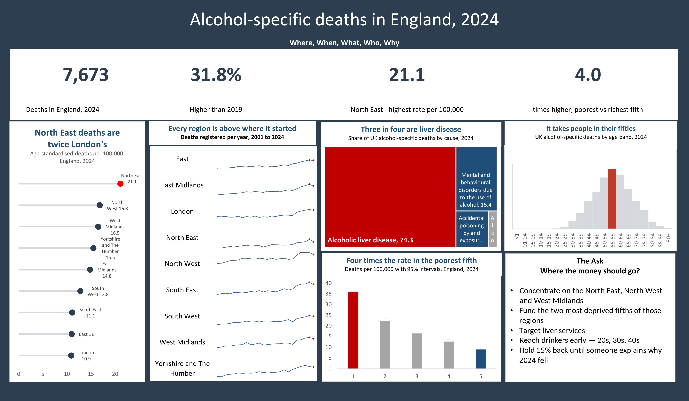

# Excel

**Contribution: a cleaning pipeline that re-runs itself, and graphics drawn inside the cells.**

The cleaning is recorded rather than performed — Power Query stores every transformation as a step, so next year's ONS release re-runs the whole thing without anything being re-typed. Four tables load to the data model rather than to worksheets, and the headline figures are calculated rather than typed, so they move when the data moves.

The five charts are five different forms: a lollipop, in-cell sparklines, a treemap, a histogram and columns carrying published 95% intervals. The sparklines are the thing no other tool on this list can do.

[`alcohol_deaths_excel.xlsx`](alcohol_deaths_excel.xlsx) — the Power Query pipeline, the data model, five charts and the dashboard.

**Honest limitation.** Excel refreshes beautifully and lays out badly. It also will not combine a horizontal bar chart with a scatter at all, which is why the lollipop is built from a scatter with an error bar used as the stick.
