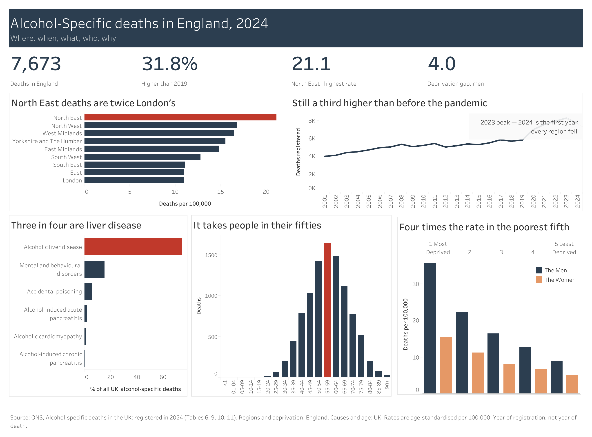

# Tableau

### [▶ Open the live version — filter it yourself](https://public.tableau.com/app/profile/ekene.ugochukwu/viz/Alcohol-specificdeathsinEngland2024/Dashboard)

**Contribution: a link rather than a file.** Everything else here needs software to open. This one filters in a browser, on a phone, in a meeting.

Each ONS sheet is connected as its own data source rather than joined — nothing needs two at once, and a bad join duplicates rows silently, which is a failure that looks like data. Fields that only *look* numeric are converted to dimensions first; left as measures, Tableau counts the years and adds up the deprivation quintiles, and both produce charts that look reasonable while being wrong.

The four headline numbers are calculated worksheets, not text boxes, so they move when the reader filters.

**Honest limitation.** Tableau Public is genuinely public and search-indexed — fine for open data under the OGL, never for anything unpublished. It also cannot refresh itself.
