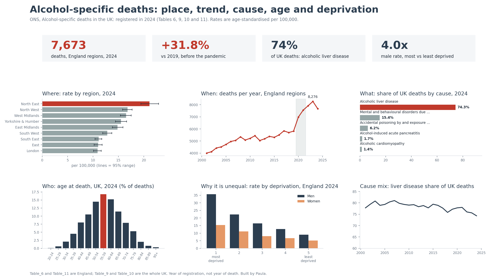

# Python

**Contribution: chart forms no spreadsheet offers, and the whole job in one run.**

The header row is found by searching for the row that starts "Year of death" rather than skipping a fixed number of lines — a fixed number breaks silently the year ONS adds a note, a search does not. One tidy function is applied to all four tables, so when the rule changes it changes in one place.

The published cause shares are joined in rather than recalculated: ONS rounds and suppresses small counts in ways a plain division will not reproduce, and the mismatch would be invisible.

Five forms, chosen because nothing else here can draw them — a ridgeline, a population pyramid, a cause-by-age heatmap, a dumbbell carrying 95% intervals, and a lollipop that takes twenty lines rather than a seven-step workaround.

[`alcohol_deaths.ipynb`](alcohol_deaths.ipynb) — cleans, answers, checks and draws.

**Honest limitation.** Nothing here is interactive and nothing updates itself. The most capable tool on the list, and the least useful to hand to someone who does not run code.
