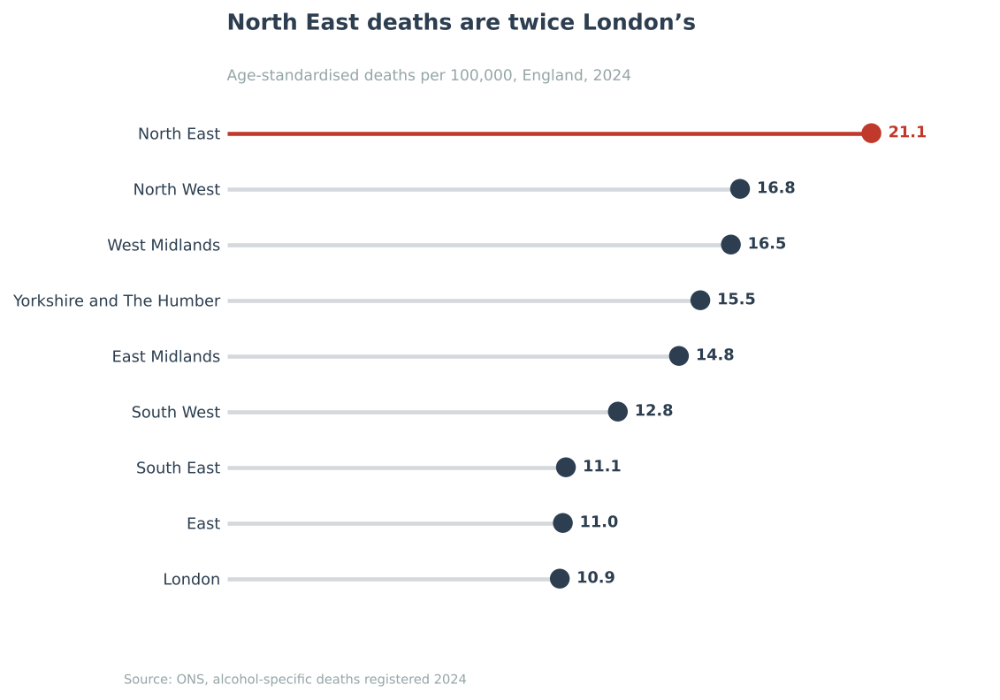
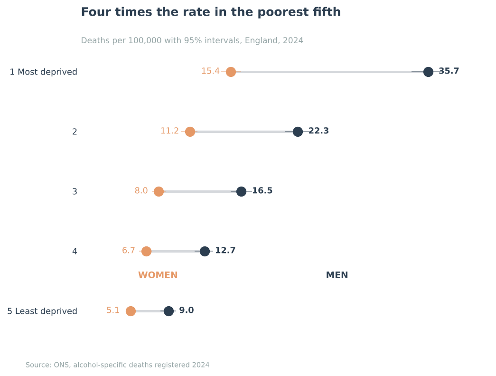
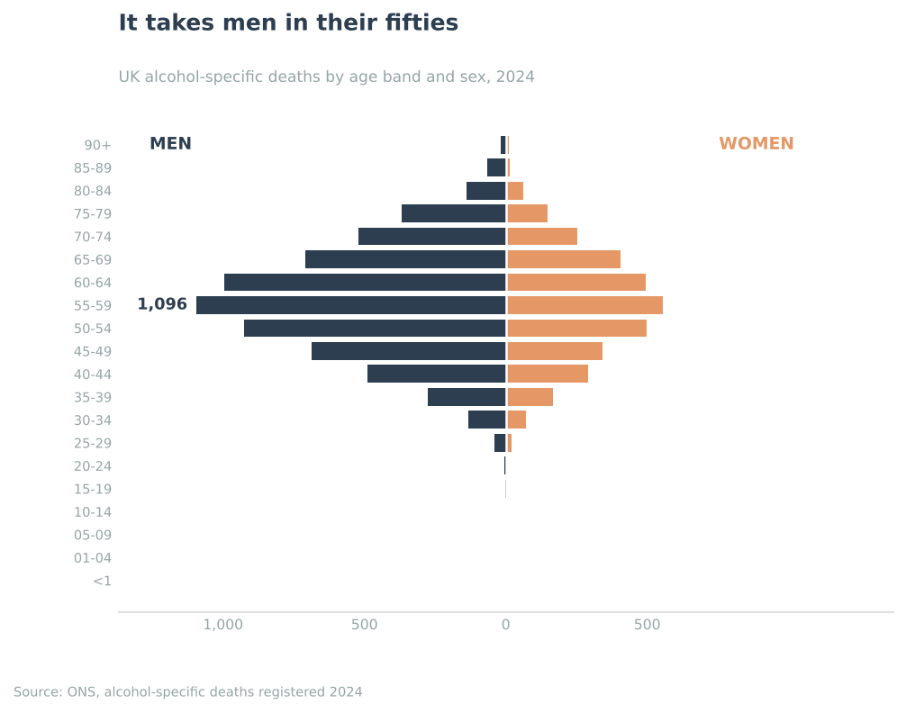
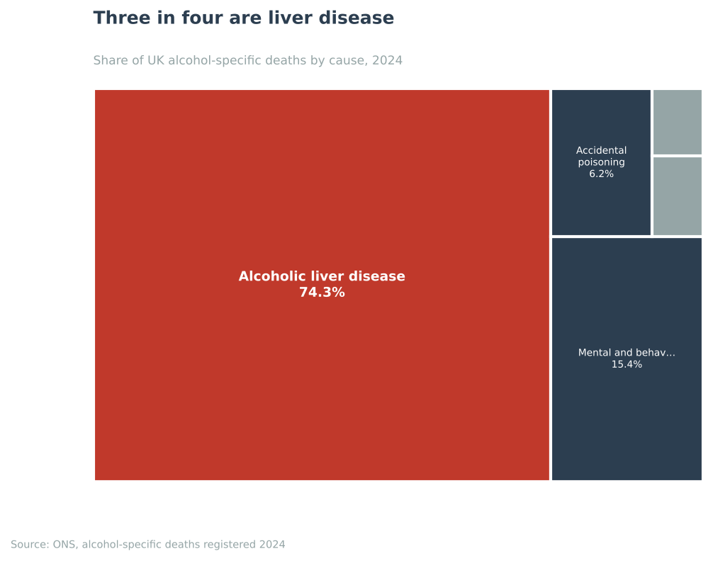
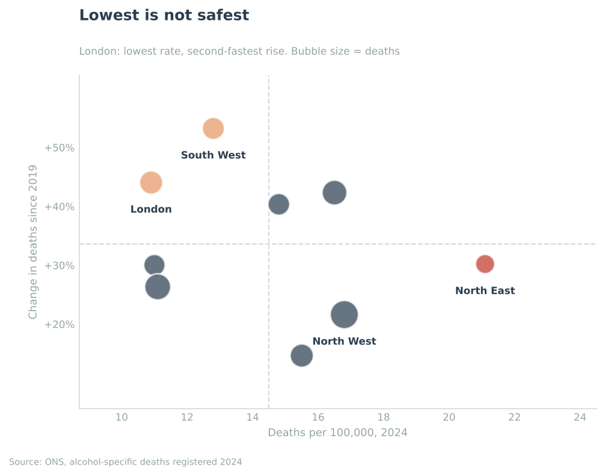
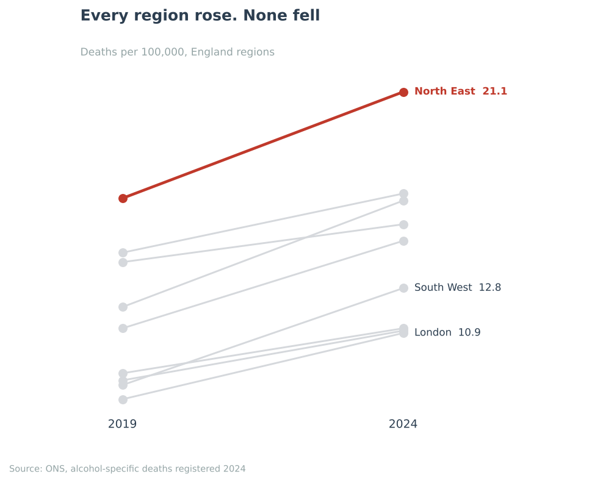
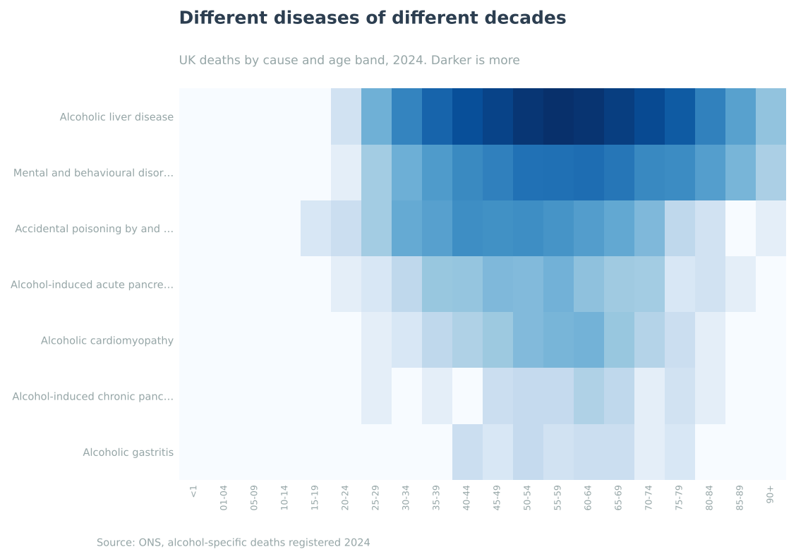
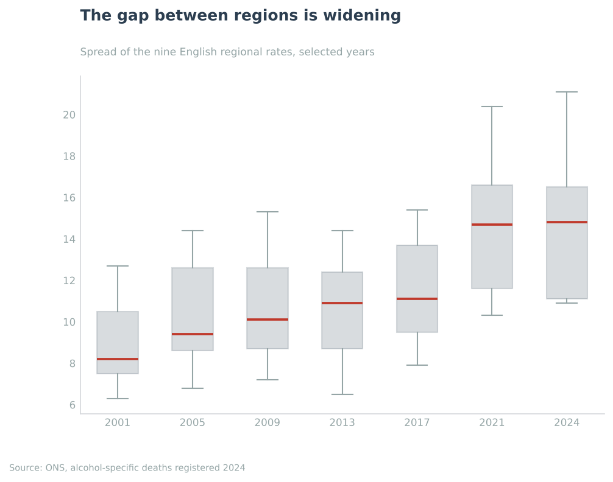
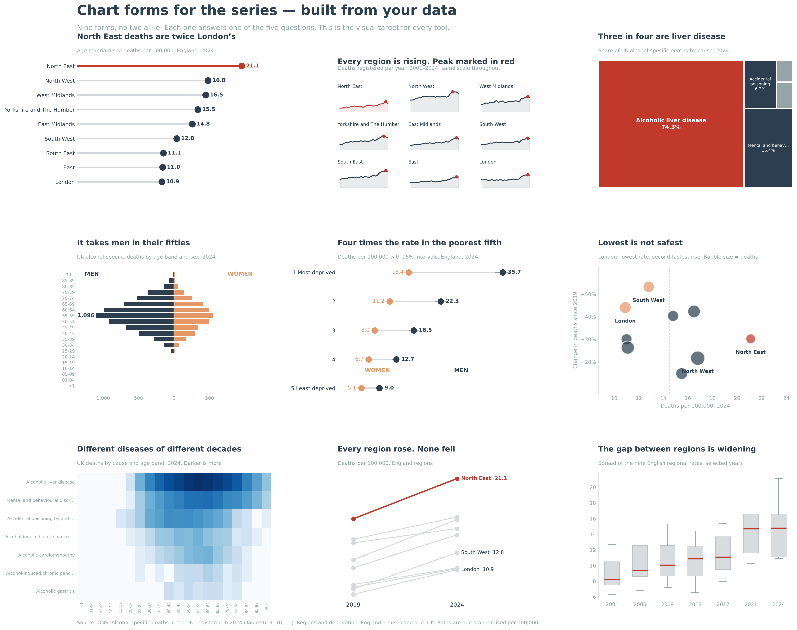

<h1 align="center">Alcohol-specific deaths in England and the UK</h1>

<b>One government dataset. Five questions. Six tools. The same answers every time.</b>

## The question

A funder wants to pay for alcohol interventions and asks one thing: **where should the money go?**

Answering it means knowing where the deaths are, which way they are moving, what people are actually dying of, who they are, and why it is not spread evenly. Five questions, answered against the same ONS release in Excel, Power BI, Tableau, SQL, SPSS and Python — every tool held to the same numbers.

## What the data says

| | Question | Answer |
|---|---|---|
| **Where** | Which region is worst? | **North East, 21.1** per 100,000 — twice London's 10.9. The 95% intervals do not overlap |
| **When** | Which way is it going? | **7,673** in England in 2024, **+31.8%** on 2019 — but **all nine regions fell in 2024**, the only time that has happened in 24 years |
| **What** | What are people dying of? | **Alcoholic liver disease: 74.3%** of UK deaths |
| **Who** | At what age? | **68.4%** die aged 45–69. The peak band is 55–59 |
| **Why** | Does deprivation track it? | Men in the most deprived fifth die at **4.0 times** the rate of the least deprived |

> **The finding I nearly missed.** Not one region peaked in 2024 — seven peaked in 2023, one in 2022, one in 2021. Any money arriving now arrives in the first year things improved, which is a harder question than the one that was asked.

## The charts

Nine forms, no two alike, each built from this data. The rule throughout: **the title states the finding, not the variable.**

| | |
|:--:|:--:|
|  |  |
|  |  |
|  |  |
|  |  |

<b>All nine forms on one sheet</b>

## The tools

| | What it contributed |
|---|---|
| [**Excel**](01-excel) | A cleaning pipeline that re-runs on next year's file, and sparklines drawn inside the cells |
| [**Power BI**](02-power-bi) | A model with drill-through, and a visual that states the finding as a sentence |
| [**Tableau**](03-tableau) | [**A live dashboard**](https://public.tableau.com/app/profile/ekene.ugochukwu/viz/Alcohol-specificdeathsinEngland2024/Dashboard) anyone can filter in a browser |
| [**SQL**](04-sql) | Window functions, and a cross-check where two tables counted two ways agree exactly |
| [**SPSS**](05-spss) | A paired t-test on the sex gap and a regression on the deprivation gradient |
| [**Python**](06-python) | Chart forms no spreadsheet offers, and the whole job in one run |

## Data

Office for National Statistics, *[Alcohol-specific deaths in the UK: registered in 2024](https://www.ons.gov.uk/peoplepopulationandcommunity/healthandsocialcare/causesofdeath/bulletins/alcoholrelateddeathsintheunitedkingdom/registeredin2024)*. Tables 6, 9, 10 and 11. The raw download and the cleaned extracts are in [`data/`](data), with definitions in [`data/DATA_NOTES.md`](data/DATA_NOTES.md).

Contains public sector information licensed under the [Open Government Licence v3.0](https://www.nationalarchives.gov.uk/doc/open-government-licence/version/3/).

## Read this before quoting any number

**Scope.** Regions and deprivation are **England**. Causes and ages are the **UK**. England had 7,673 of these deaths in 2024; the UK had 9,809. They are not interchangeable, and every chart says which it is.

**"Alcohol-specific" is a floor, not a ceiling.** It counts only deaths wholly caused by alcohol — mostly liver disease and poisoning. Deaths where alcohol played a part, such as some cancers and road deaths, are counted separately. The real toll is larger.

**Registration, not occurrence.** A death takes time to register and longer to confirm, so this release runs about a year behind. It is the most recent data that exists.

**Areas, not people.** Deprivation is measured for neighbourhoods, not individuals, and is strongly associated with these deaths rather than shown to cause any one of them.

**Where, not what.** This data can say where the harm falls and on whom. It cannot say which intervention fixes it.

---

<b>Paula Ekene Anugha-Ugochukwu</b> 
Data Science Analyst &amp; Data Storyteller

