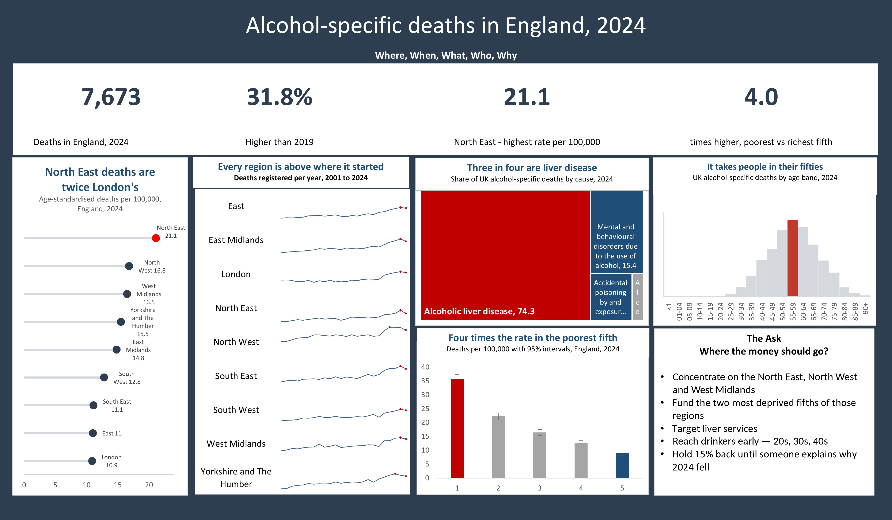
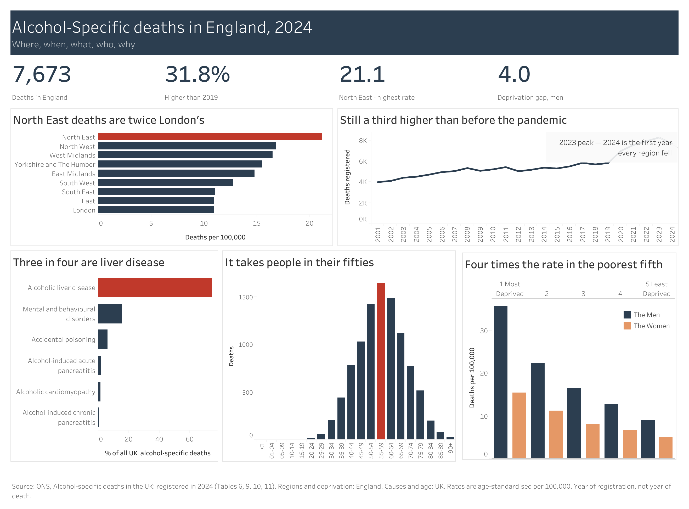

<h1 align="center">Alcohol-specific deaths in England and the UK</h1>

<b>One government dataset. Five questions. Six tools, two of them finished so far.</b>

## What I was asked

Picture a funder putting money on the table to cut alcohol deaths in England, and asking one question. Where should it go?

To answer that properly you need five things. Where the deaths are. Which way they are moving. What people are actually dying of. Who they are. And why it is not spread evenly.

I am answering those five questions against the same ONS release in six different tools, because I wanted to find out how much of a good answer comes from the software and how much comes from the thinking. Excel and Tableau are done. The other four are coming.

## What the data says

| | Question | Answer |
|---|---|---|
| **Where** | Which region is worst? | **North East, 21.1** per 100,000, twice London's 10.9. The 95% intervals do not overlap, so the gap is real |
| **When** | Which way is it going? | **7,673** deaths in England in 2024, **up 31.8%** on 2019. But **all nine regions fell in 2024**, the only time that has happened in 24 years |
| **What** | What are people dying of? | **Alcoholic liver disease: 74.3%** of UK deaths |
| **Who** | At what age? | **68.4%** die aged 45 to 69. The peak band is 55 to 59 |
| **Why** | Does deprivation track it? | Men in the most deprived fifth die at **4.0 times** the rate of the least deprived |

## The bit I nearly missed

Not one region peaked in 2024. Seven peaked in 2023, one in 2022, one in 2021.

So any money arriving now arrives in the first year things got better, and nobody has explained why they got better. That is a harder question than the one I was asked, and I would want it answered before spending anything.

## The dashboards

**Excel.** Built from the raw ONS download. Power Query does the cleaning, so when next year's file lands I point it at the new one and press refresh. Five PivotTables read from a data model rather than from worksheets. The lollipop chart at the left is not a chart Excel offers, so I built it from a scatter and a reversed error bar.

**Tableau.** The same five questions again, rebuilt from scratch, and published so it can be opened and filtered on a phone without installing anything.

[**Open the live version on Tableau Public**](https://public.tableau.com/app/profile/ekene.ugochukwu/viz/Alcohol-specificdeathsinEngland2024/Dashboard)

## Where I think the money should go

Five charts are not an answer. This is the part most dashboards leave out, so here it is in plain words.

Fund by death rate, not by population. Funding by headcount sends the money to London while the North East dies at twice the rate.

Inside those regions, go to the most deprived neighbourhoods, where the rate is four times higher.

Fund liver services specifically. Three in four of these deaths are one condition.

Aim at people in their fifties. Nine deaths in the whole UK were aged 20 to 24, against 1,651 aged 55 to 59. This is not a student problem.

And find out what changed in 2024 before funding anything new.

## What is in here

| Folder | What it holds |
|---|---|
| [`data/`](data) | The raw ONS workbook, four cleaned extracts as CSV, and notes on what every column means |
| [`dashboards/`](dashboards) | The finished Excel and Tableau dashboards as images |
| [`charts/`](charts) | Nine chart forms I am using across the series, built from this data |
| [`01-excel/`](01-excel) | The workbook itself, with the queries, the model and every chart |
| [`03-tableau/`](03-tableau) | How the Tableau version was built, and the link to it |

## Still to come

Power BI, SQL, SPSS and Python. Their folders hold the prep work I will be using, and I will write each one up properly as I finish it. Nothing in those four folders has been run end to end yet, so please do not quote a number from them.

## The data

Office for National Statistics, *[Alcohol-specific deaths in the UK: registered in 2024](https://www.ons.gov.uk/peoplepopulationandcommunity/healthandsocialcare/causesofdeath/bulletins/alcoholrelateddeathsintheunitedkingdom/registeredin2024)*. Tables 6, 9, 10 and 11. The raw download and the cleaned extracts are in [`data/`](data), with definitions in [`data/DATA_NOTES.md`](data/DATA_NOTES.md).

Contains public sector information licensed under the [Open Government Licence v3.0](https://www.nationalarchives.gov.uk/doc/open-government-licence/version/3/).

## Read this before you quote any number

**Scope.** Regions and deprivation are **England**. Causes and ages are the **UK**. England had 7,673 of these deaths in 2024. The UK had 9,809. They are not interchangeable, and every chart says which one it is using.

**Alcohol-specific is a floor, not a ceiling.** It counts only deaths wholly caused by alcohol, mostly liver disease and poisoning. Deaths where alcohol played a part, such as some cancers and road deaths, are counted elsewhere. The real toll is bigger than anything here.

**Registration, not occurrence.** A death takes time to register and longer to confirm, so this release runs about a year behind. It is still the most recent data there is.

**Areas, not people.** Deprivation is measured for neighbourhoods, not for individuals. It is strongly associated with these deaths. It is not shown to have caused any one of them.

**Where, not what.** This data can tell you where the harm falls and on whom. It cannot tell you which intervention fixes it.

---

<b>Paula Ekene Anugha-Ugochukwu</b> 
Data Science Analyst and Data Storyteller

